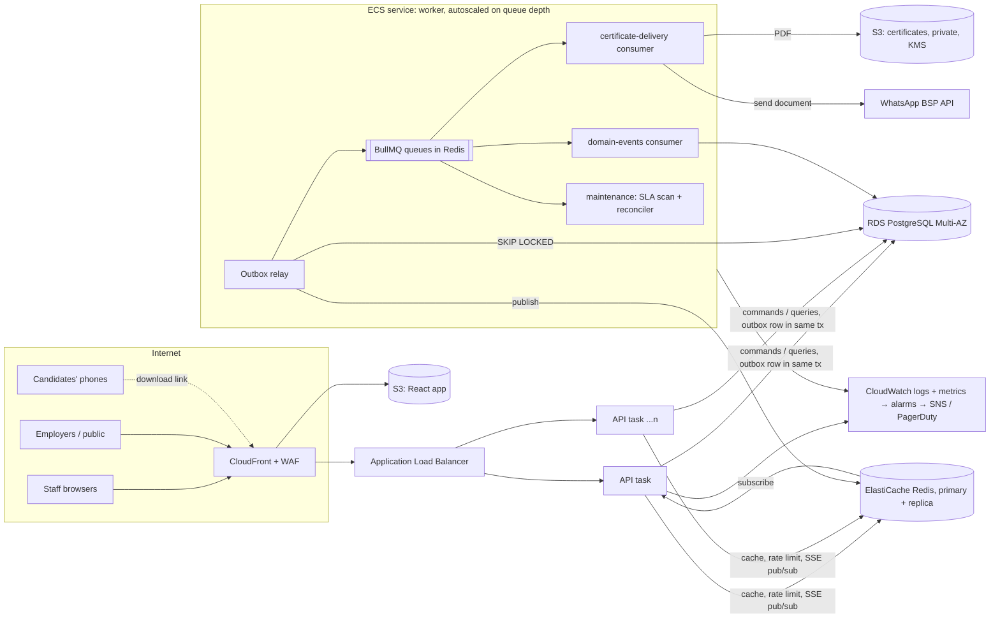

# Deployment plan

Production plan for this load:

- 100,000 registered users, ~10,000 daily active.
- Results day peak: ~500 batches approved in one hour → **~30,000 PDFs + 30,000 WhatsApp messages in an hour** (≈ 8.3 per second sustained).
- Public verification: thousands of lookups a day, in bursts (an employer drive, a viral fake).

Target: AWS **ap-south-1 (Mumbai)**. Candidates, centres and the programme are in India, so it gives low latency and keeps data in India.

## 1. Architecture

**How events flow**
1. A command handler writes its change, an audit row and an **outbox row** in one Postgres transaction.
2. The outbox relay (in the workers) claims rows with `FOR UPDATE SKIP LOCKED`. It pushes each one to the `domain-events` queue (jobId = event id, so duplicates are dropped) and publishes it on Redis pub/sub for the live UI.
3. `batch.approved` → the issue-certificates command → one `certificate.issued` event per certificate → one `certificate-delivery` job each.
4. The delivery job generates the PDF to S3 (once), sends the WhatsApp document with the certificate id as the idempotency key, and marks it SENT. Failures retry with exponential backoff; after 8 attempts the certificate is marked `FAILED` and the state office sees it.

## 2. Where each component runs, and why

| Component | Hosting | Why |
|---|---|---|
| React app | S3 + CloudFront | Static files; no servers to run; cached at the edge. |
| API | **ECS Fargate**, 2–6 tasks (0.5 vCPU / 1 GB) behind an ALB | Stateless containers (same image as local); no servers to patch; scales on CPU and request count. Two tasks minimum, in two AZs. |
| Worker | **ECS Fargate**, 2–12 tasks (1 vCPU / 2 GB) | Same image, different command. Scales on queue depth, independent of the API, so a results-day backlog never slows the website. |
| PostgreSQL | **RDS PostgreSQL 16, Multi-AZ**, db.m6g.large, gp3 100 GB, PITR 14 days | Source of truth for decisions and certificates: needs automatic failover, backups and point-in-time recovery. |
| Redis | **ElastiCache Redis 7**, cache.t4g.medium, primary + replica, Multi-AZ, AOF | Queues, cache, rate limits, pub/sub. Automatic failover; AOF keeps queued jobs across restarts. |
| Certificate PDFs | **S3** private bucket, SSE-KMS, versioning, Object Lock (governance) | Durable, cheap, no shared disk between workers. Object Lock stops issued PDFs from being edited. |
| WhatsApp | A WhatsApp **Business Solution Provider** (e.g. Gupshup / Twilio / Meta Cloud API) with an approved *utility* template | The brief's "certificate on WhatsApp". A BSP with idempotency support is preferred (see failure handling). |
| Secrets | AWS Secrets Manager → injected as ECS env | JWT and download-token secrets, DB password, BSP key; rotated without a redeploy. |
| Edge security | CloudFront + **AWS WAF** (rate-based rules, bot control on `/api/public/*`) | Bursts of public lookups and scraping are stopped before they reach the API. |

## 3. Scaling

**What scales horizontally**
- **API tasks:** stateless. The JWT is verified locally and SSE fan-out goes through Redis pub/sub, so any task can serve any user.
- **Worker tasks:** every consumer is idempotent and the relay uses `SKIP LOCKED`, so adding workers adds throughput with no coordination.
- **Read traffic for verification:** Redis cache (30 s TTL, deleted on revoke). Add an RDS read replica if lookups grow far beyond "thousands a day".

**Peak maths (results day)**

| Work | Per hour | Cost per unit | Capacity needed |
|---|---|---|---|
| Certificate rows + audit + outbox | 30k × 3 inserts ≈ 90k rows | trivial for RDS | < 30 writes/s |
| PDF generation | 30,000 | ~150 ms CPU | ≈ 1.25 vCPU continuously → 4 worker tasks give 3× headroom |
| WhatsApp sends | 30,000 (≈ 8.3/s) | network bound, ~300 ms | concurrency 10 per task × 4 tasks = ~130/s possible |

**What actually limits throughput at peak**
1. **WhatsApp provider limits.** Meta caps business-initiated messages per number by tier (1k → 10k → 100k unique users / 24 h) and by throughput (~80 msg/s on the Cloud API). 30k candidates in a day needs **Tier 3 (100k)**. This has to be arranged with the BSP before results day. It is a business task, not a code change.
2. RDS connections: Prisma pools per task are capped (`connection_limit=10`), and 12 workers + 6 API tasks stay under 200. **RDS Proxy** is added if more are needed.

**How the backlog clears**
- The queue absorbs the spike: approvals take milliseconds, and delivery jobs wait in Redis.
- Worker autoscaling uses a custom CloudWatch metric, `certificate-delivery` waiting count, pushed every 30 s. The target is 500 waiting per task, from 2 up to 12 tasks.
- A BullMQ rate limiter on the delivery queue (e.g. `max: 60 / second`) keeps us under the provider's limit, so we never get throttled into retry storms.
- At 4 tasks, a 30k backlog clears in ~1 hour (bounded by the WhatsApp rate). With a raised provider limit and 12 tasks it clears in ~15 minutes.

## 4. Failure handling

| Failure | What happens | Why nothing is lost or doubled |
|---|---|---|
| **Worker crash** (task killed mid-job) | BullMQ marks the job *stalled* after the lock expires (30 s) and gives it to another worker. ECS starts a replacement task. | Each job is idempotent: the certificate's unique `candidate_id`, the PDF reused if it already exists in S3, the WhatsApp idempotency key = certificate id, `markDelivered` conditional on not SENT. Outbox rows are only marked published after the queue accepted them; a crash in between means a re-send, which the `jobId` dedupes. |
| **Redis restart / failover** | ElastiCache promotes the replica (~30 s). API cache and rate limit fail open (verification falls back to Postgres). Workers reconnect (`maxRetriesPerRequest: null`). | Postgres is the source of truth. AOF keeps jobs; anything lost in the last second is recovered by the **reconciler** in the maintenance queue: every 5 min it re-queues certificates still `PENDING` after 10 min and issues for `APPROVED` batches missing certificates (both idempotent). Undelivered outbox rows are simply re-relayed. |
| **WhatsApp outage** | Deliveries fail and retry with exponential backoff (2 s → ~4 min over 8 attempts). After that the certificate is `FAILED` and an alarm fires. The state office sees it, and a "retry failed deliveries" action re-queues them when the provider is back. | Approvals, issuing and verification don't depend on WhatsApp, so only delivery waits. The idempotency key prevents duplicates when the provider was slow rather than down. A **circuit breaker** (pause the delivery queue when the error rate > 50 % for 2 min) avoids burning attempts during a long outage. |
| **Slow database** | Request timeouts (API 10 s), Prisma pool waits bounded (`maxWait` 10 s); the ALB health check uses `/health`; slow queries are logged (`log_min_duration_statement=500ms`). | Transactions are short and touch one batch row each; the worker backs off and retries. Mitigations in order: Performance Insights to find the query → index → scale the instance class (Multi-AZ failover ~60 s) → read replica for verification and lists. |
| **API task dies** | ALB stops routing to it; ECS replaces it. | Stateless; in-flight requests get an error and the UI retries. Browsers' SSE reconnects automatically. |
| **AZ outage** | RDS / ElastiCache fail over to the standby AZ; ECS tasks run in 2 AZs. | — |

## 5. Certificate file storage and access control

- PDFs are stored at `s3://certiflow-certificates-prod/{year}/{certificateNo}.pdf` in a **private** bucket: Block Public Access on, SSE-KMS, versioning on, Object Lock in governance mode (an issued PDF cannot be overwritten).
- Only the worker's IAM role can `PutObject`; only the API role can `GetObject`. Nobody else has access.
- **Candidates** download through the link in their WhatsApp message: `/api/public/certificates/{no}/pdf?token=…`. The API checks the HMAC token (certificate number + expiry, 30 days) and the status, so a revoked certificate gives 410. It then redirects to a **pre-signed S3 URL valid for 5 minutes**. The link cannot be guessed or reused for another certificate.
- **Staff** download through the authenticated API, using the same scope rules as the batch (own centre / district).
- **Public verification** never returns the PDF or the phone number: only status, masked name, course, centre and date.
- Revocation keeps the file (for audit and legal purposes) but blocks every download.
- Lifecycle: move to S3 Standard-IA after 90 days. Certificates are kept permanently; a revoked certificate's PDF moves to Glacier after 1 year.

## 6. Monitoring and alerting

**Metrics** (CloudWatch, with dashboards in CloudWatch or Grafana)
- API: request rate, p95 latency, 5xx rate (ALB).
- Queues: waiting / active / failed per queue, plus the age of the oldest waiting job.
- Delivery: sent per minute, failure rate, retries, `FAILED` count.
- Outbox: oldest unpublished event age.
- RDS: CPU, connections, replica lag, slow queries. Redis: memory, evictions (must stay 0), failovers.
- Business: batches per status, batches escalated (SLA), certificates issued per day.

**Alarms → SNS → on-call (PagerDuty / Slack)**

| Alarm | Threshold |
|---|---|
| API 5xx | > 1 % for 5 min |
| Outbox lag (oldest unpublished) | > 2 min |
| Oldest waiting delivery job | > 30 min on a normal day |
| Delivery failure rate | > 20 % for 10 min (probable provider outage) |
| Certificates in `FAILED` | > 0 new in 15 min |
| RDS CPU / free storage | > 80 % / < 15 % |
| Redis evictions | > 0 |
| ECS task restarts | > 3 in 10 min |

**Tracing:** every request, audit row, outbox event and job carries a `correlationId`. CloudWatch Logs Insights queries by it give the full story of a batch: request → approval → events → each delivery attempt. OpenTelemetry → X-Ray is a next step.

## 7. Rough monthly cost (ap-south-1, on-demand, USD)

| Item | Size | ≈ USD / month |
|---|---|---|
| ECS Fargate: API | 2 tasks × 0.5 vCPU / 1 GB, 24×7 (+ peak bursts) | 40 |
| ECS Fargate: workers | 2 tasks × 1 vCPU / 2 GB baseline + autoscaled peaks | 90 |
| RDS PostgreSQL | db.m6g.large Multi-AZ + 100 GB gp3 + backups | 330 |
| ElastiCache Redis | cache.t4g.medium primary + replica | 100 |
| ALB | 1 + LCUs | 25 |
| NAT gateway | 1 (+ data) | 45 |
| S3 + CloudFront + WAF | ~100k PDFs/month × 100 KB, web app, WAF rules | 30 |
| CloudWatch logs / metrics / alarms | ~50 GB logs | 40 |
| Secrets Manager, KMS | | 10 |
| **Infrastructure total** | | **≈ 710** |
| WhatsApp utility messages (India) | ~100k/month at ≈ $0.0014 | ≈ 140 |
| **Total** | | **≈ $850 / month** |

**Trade-offs**
- **Multi-AZ RDS is the largest item.** It is kept because losing approval records is the one unacceptable failure. A single-AZ instance with PITR would save ~$165 but means ~10 minutes of downtime on a host failure.
- Fargate costs more per vCPU than EC2, but needs no servers or patching and scales per task. That fits a spiky load with one big day.
- Savings Plans (1 year) on Fargate and RDS reserved instances would cut ~30 %.
- A managed broker (SQS/Kafka) was not added: Redis is already required, and BullMQ covers retries, deduplication and schedules at this volume. If delivery volume grew 10×, SQS + Lambda for PDF generation would be the next step.
- Self-hosting Postgres and Redis on EC2 would roughly halve the database cost, but we would own failover, backups and patching. That's not worth it for a small team.
